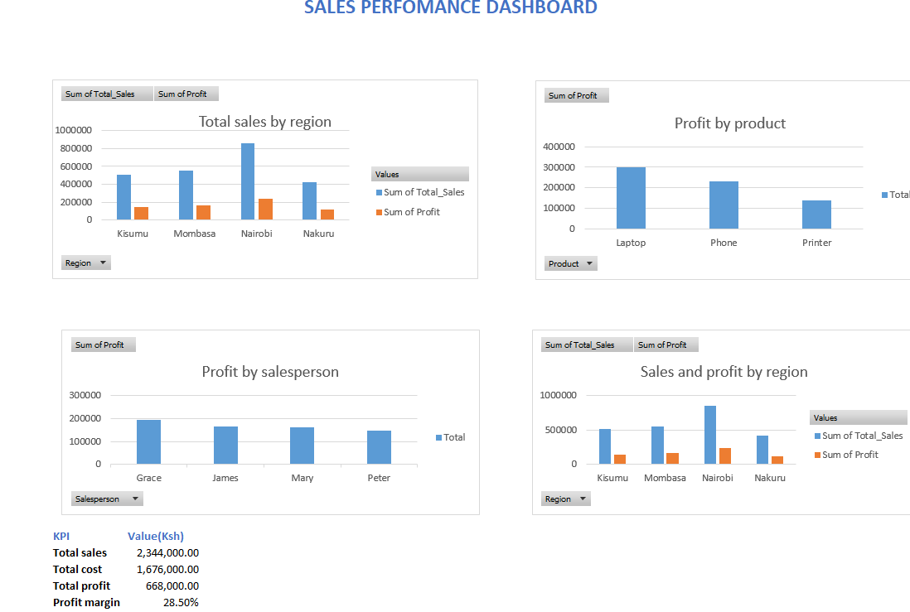

# Sales Performance Analysis Dashboard

## 1. Project Overview

This project uses Microsoft Excel to analyze sales performance for a fictional retail business operating across Nairobi, Mombasa, Kisumu, and Nakuru.

The dashboard examines sales revenue, costs, profit, product performance, salesperson performance, and regional performance.

## 2. Project Objectives

- Analyze total sales, costs, and profit.
- Compare sales performance across regions.
- Identify which products contribute most to profit.
- Compare salesperson performance.
- Present results using an interactive Excel dashboard.

## 3. Tools and Techniques

- Microsoft Excel
- Data validation and calculations
- PivotTables and PivotCharts
- Interactive slicers
- KPI calculations
- Dashboard design

## 4. Data Disclaimer

This project uses fictional demonstration data created for learning and portfolio purposes. It does not represent actual transactions, customers, employees, or financial records of any real business. All findings and recommendations are based solely on this sample dataset.

## 5. Project Files

The repository will contain the Excel dashboard and supporting documentation.

## 6. Key Findings

### Finding 1: Regional Sales Performance

Nairobi recorded the highest sales, totaling KSh 857,000, followed by Mombasa at KSh 557,000, Kisumu at KSh 510,000, and Nakuru at KSh 420,000. Nairobi contributed approximately 36.6% of total sales.

**Recommendation:** Investigate the factors contributing to Nairobi's higher sales and assess whether effective sales practices can be adapted in other regions.

Finding 2: Product Profitability

Laptops generated the highest total profit at KSh 299,000, followed by phones at KSh 231,000 and printers at KSh 138,000. Total profit across all products was KSh 668,000.

Recommendation: Examine the factors behind laptop profitability, including selling prices, costs, and sales volume. Use this analysis to inform future product and pricing decisions.

### Finding 3: Salesperson Performance

Grace generated the highest total profit at KSh 193,000, followed by James at KSh 166,000, Mary at KSh 163,000, and Peter at KSh 146,000.

**Recommendation:** Review the sales approaches and product mix associated with stronger profit performance. Share effective practices across the sales team while considering differences in assigned regions and products.

The screenshot below provides a visual overview of the Excel sales performance dashboard.

